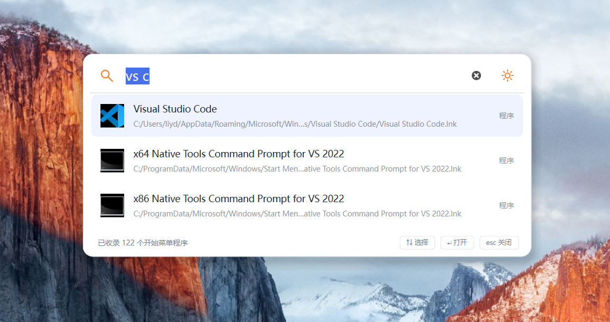

# search

Windows 10/11 x64 快捷启动工具，按下 `Alt+Space`，找到程序，立即打开。

- **快速搜索**：收录开始菜单程序、Windows 商店应用、控制面板、设置和常用系统工具，显示原生图标。
- **拼音支持**：支持中文、英文原名、全拼和首字母；常见 Windows 系统程序支持中英文别名。
- **常用程序**：按使用热度展示常用 App，支持固定和自定义搜索别名。
- **随心设置**：可调整主题、全局快捷键、失焦行为和开机启动。
- **便捷更新**：从 GitHub 检查新版本，手动下载、重启安装，保留个人设置。
- **本地搜索**：搜索和使用记录保存在本机，更新检查仅连接 GitHub。

[下载](https://github.com/tuniren/search/releases) · [文档](docs/README.md) · [0BSD 许可](LICENSE)
